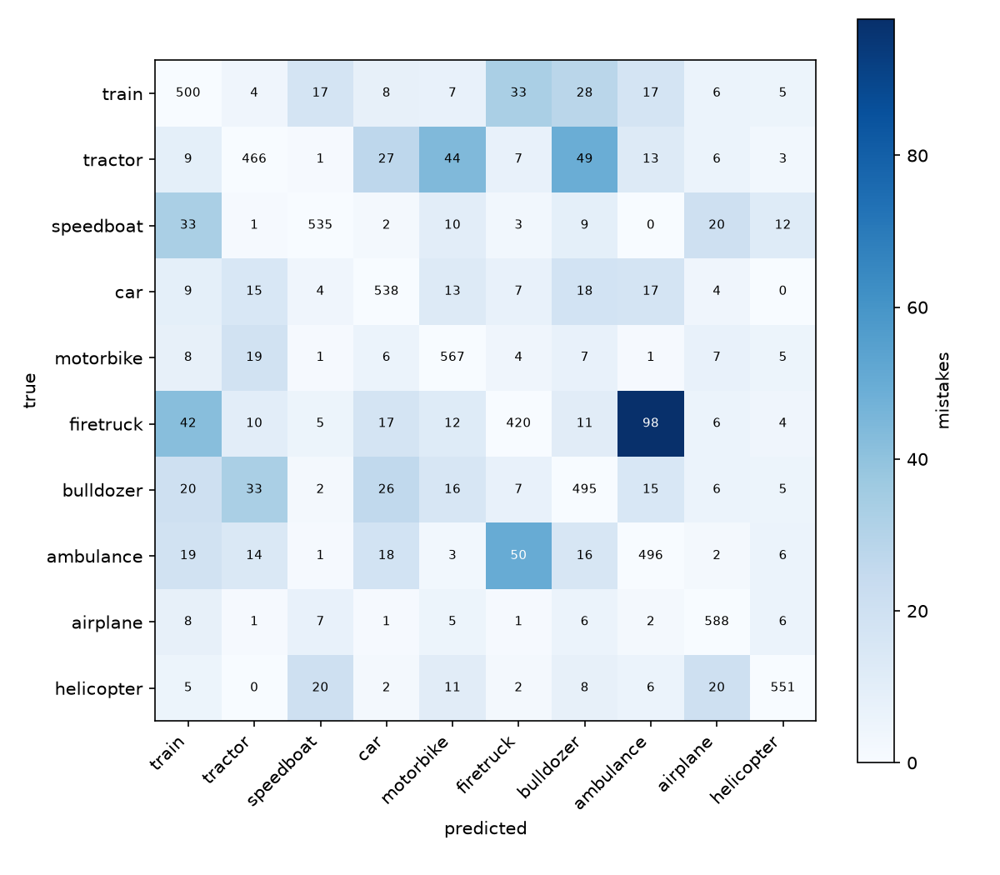

# CNN from scratch (NumPy only): Quick, Draw! vehicles
New to CNNs? Read [GUIDE.md](GUIDE.md) for a plain-language explanation of CNNs and of every step in this project.

A convolutional neural network that classifies 28×28 doodles of ten vehicles, written with **only NumPy**. Every forward and backward pass is implemented by hand: no PyTorch, TensorFlow, autograd or scikit-learn.

**Final model: 82.6% accuracy** on 10,000 previously unseen drawings (10 balanced classes, so guessing gives 10%), against 69.6% for a dense-network baseline.

Classes: train, tractor, speedboat, car, motorbike, firetruck, bulldozer, ambulance, airplane, helicopter.

## Results

Scored once on a fresh test set (1,000 drawings per class, none of them used in training or validation). Ranges are 95% sampling margins.

| Model | Validation | Fresh test |
|---|---|---|
| Dense baseline (784 → 256 → 10) | 69.3% | 69.6% ± 0.9 |
| CNN, head B | 77.6% | 78.4% ± 0.8 |
| **CNN, head B + augmentation (final)** | 82.5% | **82.6% ± 0.7** |



*Final model, validation set. Rows are the true class, columns the prediction. Colour shows only the mistakes (the diagonal is left uncoloured); the numbers are the real counts.*

## Model

```
Conv 3×3 (1→16) → ReLU → MaxPool 2×2 → Conv 3×3 (16→32) → ReLU → MaxPool 2×2
→ Flatten (1568) → Dense 128 → ReLU → Dense 10 → softmax cross-entropy
```

206,922 parameters.

- Convolution uses im2col (`sliding_window_view`, no pixel loops). Gradients flow back through col2im, a scatter-add.
- He initialisation, mini-batch SGD (learning rate 0.05, batch 64). The weights from the epoch with the lowest validation loss are kept.
- Augmentation (training batches only): random horizontal flip and random shift of up to 2 pixels.

## Correctness

22 tests (`python -m pytest tests -v`), including numerical gradient checks for every layer and for the full Conv → ReLU → Pool → Conv → ReLU → Pool → Flatten → Dense → loss chain.

## Experiments

All on 5,000 drawings per class (3,750 train / 625 validation per class), seed 0 unless noted. Accuracy is on the validation set at the best epoch.

| Experiment | Validation |
|---|---|
| Dense baseline | 69.3% |
| Head A: Flatten → Dense(10), 20.5k parameters | 77.8% |
| Head B: Flatten → Dense(128) → Dense(10) | 77.6% (seed 1: 78.2%) |
| Stacked convs: two 3×3 convs before each pool, 218k parameters | 79.7% (seed 1: 79.4%) |
| Head B + augmentation (final) | 82.5% |
| Stacked convs + augmentation | not finished (stopped after 4 epochs on a throttled laptop); it was ahead of head B + augmentation at the same epoch |

What the experiments showed:

- **Augmentation was the largest single gain (about +4 points)** and removed the overfitting gap. Without it, head B memorised the training set within a few epochs (99.8% train accuracy against 77.6% validation).
- Extra convolution layers added about 1 to 2 points, mostly on train, tractor and bulldozer.
- The remaining errors concentrate in look-alike classes: firetruck ↔ ambulance (98 + 50 mistakes on validation) and tractor ↔ bulldozer. Firetruck is the weakest class (67%). Many of these drawings are plain boxes on wheels, and some doodles are unreadable, so part of the error is probably irreducible.

## Notes on evaluation

- An earlier test set was scored once for head B (78.8%) and the baseline (70.0%). After that it had influenced further experiments, so the final numbers come from a freshly drawn set (`make_fresh_test.py`), which excludes every drawing that appears in train, validation or the old test set. Test and validation numbers agree within about a point, which suggests the model selection did not inflate the results.
- The final model is a single training run. Earlier seed comparisons moved results by 0.3 to 0.6 points.
- There is no published benchmark for this 10-class subset, so the absolute numbers have no external reference.

## Dataset

[The Quick, Draw! Dataset](https://github.com/googlecreativelab/quickdraw-dataset), Google Creative Lab, licensed under [CC BY 4.0](https://creativecommons.org/licenses/by/4.0/). It is not included in this repository. Download the 28×28 numpy bitmap files for the ten categories above (see the dataset's README) and place them in `Dataset/` as `<category>.npy`.

## Reproduce

```powershell
python -m venv .venv
.venv\Scripts\Activate.ps1
python -m pip install -r requirements.txt

python preprocess.py --per-class 5000      # builds Processed/quickdraw_vehicles_5000.npz
python train.py B 20 0 aug                 # head B + augmentation, 20 epochs, seed 0
python -m data_tools.make_fresh_test       # builds the fresh test set
python -m analysis.evaluate_fresh          # scores the saved models on it
python -m pytest tests -v
```

Run all scripts from the project root; the tools are run as modules (python -m ...).

`python train.py [baseline|A|B|C] [epochs] [seed] [aug]` selects the model. The trained weights are in `weights/`, so `python -m analysis.evaluate_fresh` works without retraining. One epoch of head B takes about 70 seconds on a laptop CPU at full speed.

## Layout

```
preprocess.py  layers.py  losses.py  model.py  train.py   core code (imported by everything else)
analysis/      evaluate_fresh.py, confusion_val.py, view_errors.py, check_augmentation.py
data_tools/    make_fresh_test.py, check_data.py
tests/         gradient checks and unit tests
weights/       saved models (.npz)
figures/       confusion matrices, example drawings
```

## Limitations and next steps

- Only 5,000 of the 116,000 to 220,000 available drawings per class are used.
- Head B + augmentation was still improving at epoch 20, so longer training may help.
- Not tried: stacked convs with augmentation (run unfinished), richer augmentation (rotation, scaling), dropout or weight decay, GPU acceleration.